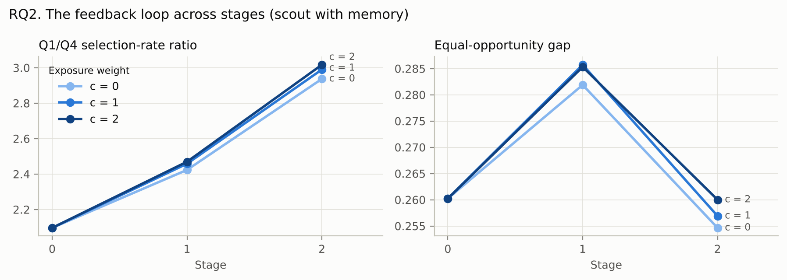
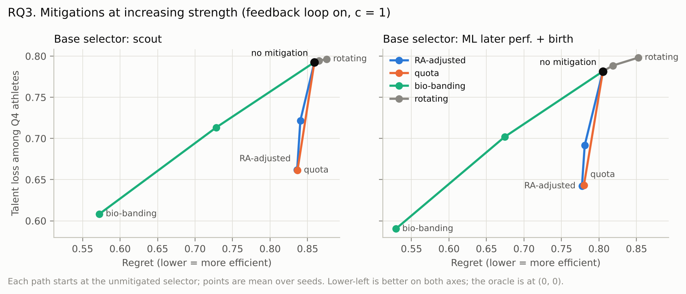
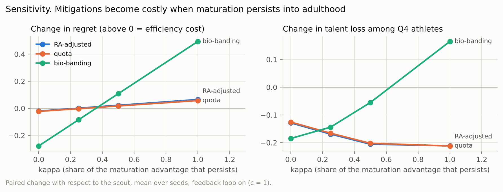

# Relative Age Effect and Feedback Loops in Youth Talent Selection: a Simulation Study of Bias Amplification and Mitigation

**Student:** Gasbarro Samuele
**Email:** samuele.gasbarro@studio.unibo.it
**Matriculation number (matricola):** 0001181115
**Course:** Ethics in AI, University of Bologna
**Document:** Project report (draft v0.5, work in progress)

---

## Abstract

Youth sport organisations select talent through multi-stage pathways (e.g., U12 to U18) and increasingly rely on data-driven tools. Annual age-grouping produces the Relative Age Effect (RAE): athletes born early in the selection year are systematically over-selected, because relative age is confounded with biological maturation. A model trained on past selection outcomes may inherit this bias and amplify it through a feedback loop: selected athletes receive more coaching and playing time, which improves their observed performance and reinforces later selections. Since real youth data are scarce and true talent is never observable, this project builds a seeded and tested Python simulator of a multi-stage selection pipeline in which latent talent is independent of birth date by construction. This makes it possible to measure directly the harm of biased selection, i.e., talented athletes born late in the year who are excluded. The study asks (RQ1) how much machine-learning selectors amplify the RAE compared with the bias already present in the data, (RQ2) whether the training-exposure feedback loop increases talent loss across stages and cohorts, and (RQ3) which mitigations (relative-age-adjusted scores, bio-banding, birth-quarter quotas, rotating selection slots) reduce talent loss and at what cost in selection efficiency. Results are reported with fairness metrics, efficiency metrics, multiple random seeds and confidence intervals. The project addresses the Trustworthy AI requirements of fairness, transparency and societal well-being, and uses no personal data. The simulator explores mechanisms and compares mitigations; it does not predict real-world outcomes.

---

## 1. Context and research questions

The Relative Age Effect (RAE) is a well-documented advantage for athletes born early in the
selection year (Cobley et al., 2009). A recent systematic review of machine learning in youth talent
identification recommends fairness audits across relative-age quartiles, sex and maturation
status (Tang et al., 2026). Real youth data are scarce and true talent is unobservable, so the harm
of biased selection cannot be measured directly; a simulation with known latent talent makes it
measurable.

- **RQ1.** How much does a selector trained on historical outcomes amplify the RAE, compared with
  the bias already present in the data?
- **RQ2.** Does the training-exposure feedback loop increase talent loss across successive stages
  and cohorts?
- **RQ3.** Which mitigations reduce talent loss, and at what cost in selection efficiency?

## 2. Model specification

**Athletes.** For athlete *i*, latent talent is T_i ~ N(0, 1), independent of birth date. The birth
date is U_i ~ Uniform[0, 1), the fraction of the selection year elapsed since the cut-off
(0 = oldest in the age group). The birth quarter Q_i is floor(4 U_i) + 1. Standardised relative age
is ra_i = (1/2 - U_i) / sqrt(1/12), and biological maturation is
M_i = rho * ra_i + sqrt(1 - rho^2) * e_i with e_i ~ N(0, 1), so M has unit variance and correlation
rho with relative age.

**Pipeline.** There are S stages. At stage s, all athletes still in the system (the pool) are
observed, and the top k_s = round(f_s * N) are selected, where f_s is a non-increasing fraction of
the initial cohort of N athletes. Observed performance is

    P_(i,s) = a * T_i + b_s * M_i + c * E_(i,s) + sigma * z_(i,s),   b_s = b_0 * delta^s,

where z is standard normal noise, delta < 1 makes the maturation effect fade at later stages, and
E_(i,s) = g * (number of earlier stages at which i was selected) is accumulated training exposure.
Selection at stage s therefore feeds exposure at stage s + 1, which closes the feedback loop.
Athletes not selected at a stage leave the system with probability p; those who stay can be
selected at a later stage. The exposure gap opens between them and the athletes who were
selected, so the loop acts through these re-entries: in a pure pyramid (p = 1) every athlete in
the pool has the same exposure and the loop has no effect on the ranking.

**Parameters and calibration.** Italian youth football groups players by calendar year of birth
(FIGC, 2025), so the cut-off is 1 January and Q1 is January-March. The correlation between
relative age and maturation follows from growth data: maturity offset is chronological age minus
age at peak height velocity (APHV); within a selection year chronological age has sd
1/sqrt(12) = 0.29 years, and APHV in male soccer players has sd of about 0.9 years
(13.6 ± 0.9 years; Malina et al., 2024), so rho = 0.29 / sqrt(0.29^2 + 0.9^2) = 0.3. The weight of
maturation b_0 is the one free parameter that sets the size of the RAE, and it is calibrated: with
b_0 = 2 the scout's Q1/Q4 ratio at the final stage (top 10% of the cohort) is about 3 (2.96
without and 3.02 with the loop), between the pooled estimate across competitive levels (odds ratio
1.65; Cobley et al., 2009, as summarised by Smith et al., 2018) and estimates for professional
academies (3 to 5; Lovell et al., 2015). The other parameters (a = 1, sigma = 1, delta = 0.7,
c = 1, p = 0.2, stage shares 30/20/10%, scout memory 1 and judgement noise 0.5) are not
calibrated and are covered by the sensitivity study (Section 5.6).

**Ground truth and the meaning of exposure.** Harm is always measured against latent talent T,
which is independent of birth date by construction. Exposure raises *observed performance* but not
T: it is the head start that coaching and playing time give to athletes who were selected early.
This keeps the definition of talent loss unambiguous. (The alternative reading, exposure as real
skill growth, leads to the same equations for P and only changes the interpretation; it is
discussed in Section 6.) The sensitivity study also relaxes the assumption that the maturation
advantage is transient: with a weight kappa > 0 the selection target becomes adult potential
T + kappa * M, so that part of the early maturers' advantage is real.

**Selectors.** Every selector receives the same view of a stage: the pool, the history of observed
performance of each athlete in it, and the number of earlier selections.

- *Oracle*: ranks by T (benchmark, not implementable).
- *Memoryless performance*: ranks by the current P only.
- *Scout* (human-like): ranks by a weighted mean of the past observations of each athlete
  (a measurement taken j stages ago has weight m^j; m = 1 averages all stages), plus a fresh
  subjective judgement error of sd tau at each stage, plus optionally an explicit bias lambda * M
  towards athletes who look physically mature. The historical data on which ML models are
  trained are produced by a scout (m = 1, tau = 0.5), with lambda = 0 ("scout") or lambda = 0.5
  ("biased scout").
- *ML selectors*: a logistic/linear model (pooled over stages or one per stage) or gradient
  boosting, trained on the logs of past cohorts (Section 4.2).
- *Mitigations* (RQ3), each wrapping a base selector (scout or ML):
  - *relative-age-adjusted scores*: the within-pool linear trend of the scores on birth position
    is estimated and a share (the strength) of it is subtracted;
  - *birth-quarter quotas*: a share of the slots is reserved to each birth quarter in proportion
    to its size in the pool, filled by the best scores within the quarter;
  - *bio-banding*: the same, with three bands of *estimated* maturation (error sd 0.5, redrawn at
    each stage) instead of birth quarters, so that athletes compete with peers of similar maturity;
  - *rotating selection slots*: at the development stages (not the final one) a share of the
    slots goes to athletes drawn at random among the next k below the cut, which spreads training
    exposure over more athletes.

**Metrics (latent talent known).** With "high talent" meaning the top 10% of T:

- *Talent loss*: share of high-talent athletes not selected, overall and by birth quarter, at the
  final stage and at every stage; the loss among Q4 athletes is the harm named in the abstract
  (talented athletes born late in the year who are excluded); *equal-opportunity gap*: largest difference in talent loss
  across quarters.
- *Selection-rate ratio* Q1/Q4 among all athletes (1 means birth date plays no role); this
  measures *disparity*, which is not the same as *harm*: a selector can increase the ratio and
  still lose fewer talented athletes (Section 5).
- *Efficiency*: mean latent talent of the selected cohort; *regret*: gap to an oracle cohort of the
  same size.

Results are averaged over independent seeds and reported with 95% Student-t confidence intervals.
Selectors compared under the same seed face identical athletes and noise, so their differences
are paired.

## 3. Goals and deliverables

| Level | Goal | Deliverable | Status |
|---|---|---|---|
| Core | Simulator and baseline selectors; answer RQ1 and RQ2 | Tested Python code, plots, confidence intervals over multiple seeds | Done (Sections 4, 5.1-5.4) |
| Extended | Mitigations (RQ3: the four listed in the proposal, at least two); sensitivity analysis | Pareto curves of talent loss vs efficiency; sensitivity study | Done, all four mitigations (Sections 5.5-5.6) |
| Stretch | Explanation analysis; calibration to the literature | Feature-attribution study of birth-quarter proxies; calibrated RAE magnitude | Done as a feature ablation (5.2) and a one-parameter calibration (2) |

Trustworthy AI requirements addressed: fairness and non-discrimination (main focus), transparency
(open modelling assumptions), societal well-being (youth participation) and human agency
(mitigations support coaches and scouts rather than replace them). No personal data are used.

## 4. Implementation

### 4.1 Package and build

Python package `rae` (NumPy, pandas, scikit-learn, SciPy, Matplotlib), tested with pytest and linted with ruff;
Makefile as build automation; continuous integration (lint and tests) on every push and merge
request. Runs are seeded, and athletes, noise, dropout and selector draws (e.g., scout judgement
error) come from separate random streams, so that selectors compared under the same seed face
identical athletes (common random numbers). See `README.md` for the repository layout.

At each stage the pipeline builds a *stage context* (stage, pool, observed-performance history,
earlier selections, selector random stream) and asks the selector for one score per athlete; the
top k_s scores are selected. New selectors only need to implement this interface; selectors that
decide *who* is selected in another way (quotas, bands, rotating slots) can also return the chosen
positions directly, and the pipeline checks that they are k distinct members of the pool.

### 4.2 Stage logs and learning selectors

Each run records, for every stage, the pool, the observed-performance history, the number of
earlier selections of each athlete and the selection decision. These logs are the "historical
data" on which machine-learning selectors are trained. Features are the current observed
performance, the mean observed performance over all stages so far (the same memory a scout has),
the number of earlier selections (training exposure) and the stage; birth information (position
in the selection year) can be withheld or added, to test fairness through unawareness. Two
labelling regimes are implemented: *decisions* (label = past selection decision of the scout) and
*later performance* (label = performance observed at the next stage, available only for athletes
still in the system, a selective-labels problem). Models are a linear/logistic model pooled over
stages (default), the same model fitted separately for each stage (equivalent to full
interactions with the stage; a stage without training rows uses the closest earlier one), and
gradient boosting. The feature set can be restricted, which is used for the ablation study.

### 4.3 Retraining across cohorts

Generation 0 is historical data from the scout. A model trained on it is deployed on the next
cohorts (generation 1), then retrained on its own decisions and outcomes, and so on. Each cohort
is an independent birth year simulated from its own seed, so the only channel through which one
cohort affects the next is the data the model is retrained on.

### 4.4 Invariants (tested)

Written before the experiments, in a test-driven spirit:

- talent is independent of birth date; maturation has the requested correlation with relative age;
- the oracle loses no high-talent athlete when the final selection share is at least the
  high-talent share, and shows no RAE even when observations are biased;
- with no maturation and no exposure effect, no RAE appears, for the memoryless selector, for a
  noisy scout with memory, for every ML selector (both regimes, with or without birth information)
  and along the retraining loop;
- the RAE grows with the strength of maturation and with the scout's maturation bias;
- the feedback loop increases the Q1/Q4 ratio for the same athletes and noise; for a scout with
  memory it also increases talent loss and regret (large cohort, strong loop);
- a decision-imitation model reproduces a noiseless historical selector (overlap above 95-98%);
- a scout without memory is exactly the memoryless selector; the observed-performance history
  is complete and consistent with the earlier stages;
- with a persistent maturation advantage (kappa > 0) the target changes but the athletes do not,
  and the oracle still loses nobody;
- every mitigation at strength 0 reproduces its base selector; relative-age adjustment removes the
  linear birth trend exactly; quotas and bands fill every group in proportion; rotating slots
  only rotate below the cut and leave the final stage alone; relative-age adjustment, quotas and
  bio-banding cut the scout's Q1/Q4 ratio by at least 40%; rotation spreads exposure over more
  athletes.

### 4.5 Experiments and figures

Each research question has a script in `experiments/` (`make calibration`, `make baseline`,
`make rq1`, `make rq2`, `make ablation`, `make rq3`, `make sensitivity`); they write one CSV row per run to `results/` (not tracked), and
`make figures` draws the report figures from those files into `report/figures/`. Shared settings
(scout presets, exposure weights) live in `experiments/common.py`.

## 5. Experiments and results

All numbers come from the calibrated model (Section 2): 20,000 athletes per cohort, 30 seeds for
the baseline, 20 for RQ1, the ablation and RQ3, 10 for RQ2 and the sensitivity study. 95% Student-t
confidence intervals are given as ±; differences between selectors are paired (same test cohort).
The scripts and `make figures` reproduce every table and figure. Absolute values depend on the
model; the comparisons are what the study is about.

### 5.1 Baseline: memory and the feedback loop

Final stage, mean over 30 seeds (CI half-width at most 0.08 for ratios and 0.013 for losses):

| Selector | Loop | Q1/Q4 ratio | Talent loss | Q4 talent loss | EO gap | Regret |
|---|---|---|---|---|---|---|
| Oracle | off/on | 1.00 | 0.000 | 0.000 | 0.000 | 0.000 |
| Memoryless performance | off | 2.30 | 0.626 | 0.726 | 0.209 | 0.742 |
| Memoryless performance | on (c = 1) | 2.68 | 0.629 | 0.743 | 0.242 | 0.746 |
| Scout with memory | off | 2.96 | 0.666 | 0.782 | 0.247 | 0.848 |
| Scout with memory | on (c = 1) | 3.02 | 0.669 | 0.786 | 0.249 | 0.857 |

Two-thirds of the most talented 10% are not in the final selection even without any bias beyond
maturation: early observations are dominated by maturation (b_0 = 2), which is consistent with the
low predictive value of youth selection reported in the literature. The scout's memory is a
channel of the RAE in its own right: averaging all stages keeps alive the first impression, taken
when maturation matters most, so the scout is both more biased (ratio 2.96 against 2.30) and less
efficient (regret 0.85 against 0.74) than a selector who only looks at the current stage. The
training-exposure loop raises the ratio for both selectors but changes talent loss only slightly.
(In an earlier, uncalibrated version of the model, with rho = 0.6 and b_0 = 1, the loop even
*reduced* the memoryless selector's talent loss, because the count of earlier selections acted as
a memory of earlier measurements; this is why the scout with memory is the reference human-like
selector, decision D1.)

### 5.2 RQ1: amplification by ML selectors

(The figure shows the pooled linear models.) Q1/Q4 ratio on a fresh test cohort, loop off, mean over 20 seeds, and in brackets the paired
difference with the historical selector. Three model classes: pooled linear/logistic, the same
model fitted per stage, and gradient boosting (GBM):

| Selector | Historical: scout | | | Historical: biased scout | | |
|---|---|---|---|---|---|---|
| | *linear* | *per stage* | *GBM* | *linear* | *per stage* | *GBM* |
| Historical selector | 2.95 | 2.95 | 2.95 | 3.36 | 3.36 | 3.36 |
| ML decisions, no birth info | 3.04 (+0.09) | 3.04 (+0.09) | 3.04 (+0.08) | 3.07 (-0.29) | 3.08 (-0.28) | 3.08 (-0.28) |
| ML decisions, birth info | 3.05 (+0.09) | 3.03 (+0.08) | 3.08 (+0.13) | 3.48 (+0.12) | 3.48 (+0.12) | 3.56 (+0.20) |
| ML later perf., no birth info | 3.01 (+0.06) | 3.01 (+0.06) | 2.98 (+0.03) | 3.00 (-0.36) | 3.01 (-0.35) | 2.99 (-0.37) |
| ML later perf., birth info | 3.19 (+0.24) | 2.81 (-0.14) | 2.97 (+0.02) | 3.20 (-0.16) | 2.81 (-0.54) | 2.94 (-0.42) |

CI half-widths of the paired differences are 0.06-0.08 (up to 0.12 for GBM). Every ML selector loses fewer talented
athletes than the selector that produced its data (talent loss 0.65-0.66, against 0.67 for the
scout and 0.72 for the biased scout). Three mechanisms appear, and all are small once the model is
calibrated.

1. *Denoising.* A model imitating a noisy scout keeps the systematic part of the judgement and
   drops the noise: the disparity grows slightly (+0.06 to +0.09, at the edge of significance)
   while talent loss falls. Amplification of disparity and harm do not go together.
2. *Proxy reconstruction.* The biased scout favours physically mature athletes, which the model
   cannot see. Without birth information the model cannot reproduce that bias (ratio 3.36 to
   about 3.0); with birth information it uses birth date as a proxy for maturation and slightly
   exceeds the historical selector (+0.12 ± 0.07 linear, +0.20 ± 0.10 GBM). The effect is small because birth date is a weak proxy
   for maturation (rho = 0.3); in the uncalibrated model (rho = 0.6) it was +1.6.
3. *Label bias, mediated by the model specification.* Performance at the next stage still contains
   maturation, with a weight that falls from stage to stage, so the right correction for birth
   date has a different sign at different stages. The pooled linear model applies one coefficient
   to every stage and carries the early-stage label bias into the final selection (+0.24); the same
   model fitted per stage does not amplify, and even corrects (-0.14), as does gradient boosting
   (+0.02 ± 0.12). Whether a model trained on later performance amplifies the RAE is a property of
   the model as well as of the data.

With the loop on the picture is the same (e.g., pooled linear, later performance with birth info:
+0.17 ± 0.07 over the scout; per-stage: -0.19 ± 0.07).

**Ablation: which features carry birth information?** In the scout's training logs, birth
position is correlated with every performance feature (current performance -0.22, history mean
-0.25, number of earlier selections -0.14); together they explain 6.3% of its variance. Birth-blind
models trained on feature subsets (paired change of the ratio vs the scout, loop off; talent loss
and regret of the later-performance model):

| Features (no birth info) | Decisions | Later performance | Talent loss | Regret |
|---|---|---|---|---|
| All | +0.09 ± 0.06 | +0.06 ± 0.06 | 0.648 | 0.803 |
| Without number of earlier selections | +0.10 ± 0.06 | +0.05 ± 0.05 | 0.649 | 0.802 |
| Without history mean | -0.29 ± 0.08 | -0.34 ± 0.08 | 0.628 | 0.744 |
| Current performance and stage only | -0.67 ± 0.09 | -0.67 ± 0.09 | 0.627 | 0.745 |

The proxy is the *memory* of past performance, not the count of past selections. Removing it
lowers the disparity *and* the talent loss, for the same reason as in Section 5.1: the history
mean is dominated by the first, maturation-heavy observation. This is not general: in the
uncalibrated model the history mean carried more information about talent, and removing it cost
efficiency. Whether dropping a proxy costs accuracy depends on how much of the proxy is signal.

### 5.3 RQ2 across stages

Scout with memory, mean over 10 seeds, stages 0 / 1 / 2:

| Exposure weight c | Q1/Q4 ratio | Talent loss | EO gap |
|---|---|---|---|
| 0 | 2.10 / 2.42 / 2.94 | 0.425 / 0.513 / 0.664 | 0.260 / 0.282 / 0.255 |
| 1 | 2.10 / 2.46 / 2.99 | 0.425 / 0.517 / 0.667 | 0.260 / 0.286 / 0.257 |
| 2 | 2.10 / 2.47 / 3.02 | 0.425 / 0.519 / 0.668 | 0.260 / 0.285 / 0.260 |

The disparity grows across stages even without the loop, because the scout's memory accumulates
the early impressions. The loop adds to it, and it does increase talent loss, but only slightly:
the paired increase in final talent loss is +0.0026 ± 0.0016 at c = 1 and +0.0039 ± 0.0022 at
c = 2 (for the memoryless selector, +0.009 ± 0.004 at c = 2). The answer to the "stages" part of
RQ2 is therefore yes, but with a small effect compared with maturation and memory.

### 5.4 RQ2 across cohorts

Moving from the scout to an ML selector causes a one-off shift at generation 1 (ratio from 2.93
to 3.12-3.33; talent loss from 0.669 to about 0.65); retraining on its own decisions for four
further generations does not compound either (ratio 3.03-3.37, talent loss 0.644-0.653). Cohorts
are independent birth years, so the only memory across generations is the model, and it reaches a
fixed point after one retraining. The answer to the "cohorts" part of RQ2 is no, under the
assumption that nothing but the model carries over from one cohort to the next.

### 5.5 RQ3: mitigations

Paired change with respect to the unmitigated selector, loop on (c = 1), mean over 20 seeds:

| Mitigation | Scout: Q1/Q4 | Scout: d Q4 loss | Scout: d regret | ML: Q1/Q4 | ML: d Q4 loss | ML: d regret |
|---|---|---|---|---|---|---|
| None | 3.01 | - | - | 3.18 | - | - |
| RA-adjusted 0.5 | 1.61 | -0.071 | -0.019 | 1.45 | -0.090 | -0.024 |
| RA-adjusted 1.0 | 1.01 | -0.131 | -0.023 | 1.00 | -0.139 | -0.028 |
| Quota 0.5 | 3.01 | 0.000 | 0.000 | 3.17 | 0.000 | 0.000 |
| Quota 1.0 | 1.00 | -0.131 | -0.023 | 1.00 | -0.138 | -0.025 |
| Bio-banding 0.5 | 2.47 | -0.079 | -0.131 | 2.57 | -0.080 | -0.131 |
| Bio-banding 1.0 | 1.57 | -0.184 | -0.287 | 1.56 | -0.191 | -0.276 |
| Rotating 0.2 | 3.03 | +0.002 | +0.006 | 3.21 | +0.007 | +0.013 |
| Rotating 0.4 | 3.06 | +0.004 | +0.016 | 3.23 | +0.017 | +0.047 |

(ML = pooled linear model trained on later performance with birth info, the strongest amplifier
in RQ1. CI half-widths are at most 0.011 for the changes in Q4 loss and 0.011 for regret.)

- *Relative-age adjustment and full quotas* remove the disparity (ratio about 1, equal-opportunity
  gap from 0.25 to 0.03-0.04), cut the loss among Q4 athletes from 0.79 to 0.66, and slightly
  improve efficiency (regret -0.02). A half quota does not bind at all: it guarantees each quarter
  half of its proportional share, and with a ratio of 3 the Q4 share of the selection (12.7%) is
  already above the guaranteed 12.5%.
- *Bio-banding* is by far the most efficient mitigation (regret -0.29), because most of the
  variation in maturation is *within* birth quarters (rho = 0.3) and only a maturation-based
  mitigation can see it; it leaves some disparity (ratio about 1.6) because memory and exposure
  still favour early-born athletes.
- *Rotating slots* do not help in any configuration tested, including a feedback loop four times
  stronger and no dropout (Section 5.6): spreading exposure costs efficiency and the loop is too
  weak for the spread exposure to pay back.
- Results are the same with the loop off.

### 5.6 Sensitivity study

One parameter at a time around the calibrated defaults, loop on, 10 seeds. Changes of the
mitigations (full strength) are paired with the scout:

| Parameter | Levels | Scout Q1/Q4 | d regret: RA-adj. / quota / bio-banding | d Q4 loss: RA-adj. / quota / bio-banding |
|---|---|---|---|---|
| rho | 0.15 / 0.3 / 0.45 / 0.6 | 1.7 / 3.0 / 5.9 / 13.2 | RA and quota -0.01 to -0.11 (grow with rho); bio about -0.28 at every level | RA and quota -0.06 to -0.28; bio -0.15 to -0.26 |
| b_0 | 1 / 2 / 3 | 2.1 / 3.0 / 3.6 | RA and quota -0.01 to -0.02; bio -0.15 / -0.28 / -0.31 | -0.10 to -0.19 at every level |
| delta | 0.5 / 0.7 / 0.9 | 2.7 / 3.0 / 3.3 | unchanged pattern | unchanged pattern |
| sigma | 0.5 / 1 / 1.5 | 3.2 / 3.0 / 2.8 | unchanged pattern | unchanged pattern |
| high-talent share | 5 / 10 / 20% | 3.0 | unchanged | about -0.14 / -0.13 / -0.11 (RA, quota) |
| exposure weight c | 0 / 1 / 2 | 2.9 / 3.0 / 3.0 | unchanged | unchanged |
| scout noise tau | 0 / 0.5 / 1 | 3.1 / 3.0 / 2.9 | unchanged | unchanged |
| **kappa** | 0 / 0.25 / 0.5 / 1 | 3.0 | RA -0.02 / 0.00 / +0.02 / +0.07; quota similar; bio -0.28 / -0.09 / +0.11 / +0.49 | RA -0.13 / -0.17 / -0.21 / -0.21; bio -0.19 / -0.14 / -0.06 / +0.17 |

The qualitative conclusions survive every parameter except kappa. rho and b_0 change the size of
the RAE and of the gains, not their direction; rotating slots never help (at c = 4 and rotation 0.4:
talent loss +0.013 ± 0.004, regret +0.034 ± 0.008). kappa, the share of the maturation advantage
that persists into adult potential, decides whether mitigations are free. Above about 0.25 the
birth-based mitigations start to cost efficiency (while still reducing the loss of late-born
potential), and above about 0.35 bio-banding becomes costly; at kappa = 1 it costs 0.49 in regret
and even increases the loss of Q4 potential. The most efficient mitigation in a world where
maturation is transient is the most harmful one if maturation is partly real.

## 6. Modelling decisions

### 6.1 Decision log

- **D1. Exposure and the human-like baseline.** Harm is measured against latent talent T, and
  exposure is a head start on observed performance, not a change of T. Because a count of earlier
  selections is also a memory of earlier measurements, the reference human-like selector is a
  scout *with memory*; the memoryless selector is kept as a contrast. Reading exposure as real
  skill growth would give the same equations for P; it was not chosen because it would make the
  ground truth depend on the selection itself and blur the definition of talent loss.
- **D2. Historical data from noisy and biased scouts.** A noiseless performance-based selector is a
  deterministic function of the features the ML model sees, so imitation is exact and the
  *decisions* regime could not show anything. Historical data now come from a scout with
  judgement noise and, in a second condition, a bias towards physical maturity.
- **D3. Independent cohorts.** Each cohort is a new birth year; the cross-cohort feedback loop of
  RQ2 is the retraining of the model on its own outputs. No other persistence is modelled.
- **D4. Talent loss at every stage**, not only at the final one, as RQ2 asks about stages.
- **D5. Student-t confidence intervals**, since the number of seeds is small (10-30).
- **D6. Mitigations as wrappers.** Every mitigation wraps a base selector, so the same mitigation
  can be applied to a scout or to an ML model and compared on the same test cohort. Bio-banding
  uses an estimate of maturation with error, not the true value; rotation is limited to the
  development stages, since the final squad should not contain random picks.
- **D7. Report figures are tracked.** Figures are generated by `make figures` but kept in
  `report/figures/`, so that the Markdown report renders on its own.
- **D8. Parameters from data where possible, calibration otherwise.** rho is derived from the
  variability of age at peak height velocity; b_0 is calibrated to a published RAE magnitude;
  the remaining parameters are varied in the sensitivity study. Earlier drafts used rho = 0.6
  and b_0 = 1, which overstated the link between birth date and maturation by a factor of two.
- **D9. Persistent maturation as a sensitivity parameter.** Whether early maturation predicts
  adult performance is uncertain, so it is not part of the default model but is varied (kappa),
  because it decides whether mitigations have a cost.
- **D10. Per-stage linear model.** Added to test the explanation of the difference between the
  pooled linear model and gradient boosting in RQ1.

### 6.2 Open decisions

- **Perceived maturity.** The biased scout weighs true maturation M; a noisy perception of M
  would be more realistic.
- **Selective labels.** Dropped-out athletes have no later performance; how much this, rather
  than the label itself, drives the behaviour of the later-performance models is not separated.
- **Female sport and other sports.** The calibration targets male football; the RAE is smaller in
  female sport (Smith et al., 2018), which corresponds to a smaller b_0.

## 7. Discussion: what the simulation says about the ethics of data-driven talent selection

### 7.1 Which fairness, and why birth quarter matters

Birth quarter is not a legally protected attribute, but it is a morally arbitrary one: nobody
chooses it, it says nothing about an athlete's potential (by construction here, and as far as
adult performance goes in reality), and it is set by an administrative rule, the 1 January cut-off.
Excluding a talented athlete because they were born in November is a harm of the same kind as
other forms of discrimination by a morally irrelevant trait, and it falls on minors.

The project uses two families of fairness measures. The Q1/Q4 selection-rate ratio is a
*demographic-parity* view: it asks whether quarters are selected at the same rate. Talent loss by
quarter and the equal-opportunity gap are an *equal-opportunity* view in the sense of Hardt et al.
(2016): among athletes who deserve selection (high talent), are the quarters selected at the same
rate? A simulation can compute the second measure, because talent is known; real audits cannot,
and have to rely on the first. The results show why that matters: in RQ1 most ML selectors
increased the ratio slightly while losing fewer talented athletes, and when part of the maturation
advantage is real (Section 5.6) a ratio of 1 is no longer the right target. Disparity is evidence
of a problem, not a measure of harm.

### 7.2 Fairness through unawareness and proxies

Withholding birth date from a model ("fairness through unawareness") has two opposite effects in
the simulation. When the historical bias acts through a trait the model cannot see (the biased
scout's preference for physical maturity), withholding birth date stops the model from
reconstructing that bias: the model is fairer than its training data. When birth date is
available, the model uses it as a proxy and slightly exceeds the historical bias. At the same
time, birth information leaks into birth-blind features through the memory of past performance.
In the calibrated model removing that feature reduced both disparity and talent loss, but in the
uncalibrated one it cost efficiency: whether dropping a proxy costs accuracy depends on how much of
the proxy is signal. Unawareness is therefore neither useless nor sufficient: whether it helps
depends on the causal path of the bias, which is exactly what an audit has to establish.

### 7.3 Feedback loops and performativity

The proposal's central worry was a runaway feedback loop (Ensign et al., 2018): selected athletes
get more training, perform better, and are selected again. In the calibrated model the loop is
real but small compared with maturation: it raises the disparity monotonically, increases talent
loss only slightly, and does not compound across cohorts, because each cohort is a new birth
year and the model reaches a fixed point after one retraining. Deploying a model is still a
*performative* act (Perdomo et al., 2020): its decisions shape the data it will be retrained on,
and the one-off shift at deployment is where most of the change happens. Two caveats keep this
from being reassuring. The size of the loop is the least constrained parameter of the model, and
the human scout with memory is itself a loop: early impressions, taken when maturation matters
most, are carried to the final decision.

### 7.4 Selective labels and model dependence

A model trained on "later performance" learns only from athletes who were still in the system,
i.e., from the outcomes of past selections: a selective-labels problem (Lakkaraju et al., 2017).
In the simulation the label itself is biased (it still contains maturation), and whether the model
amplifies the RAE depends on whether it can represent stage-specific effects: a pooled linear
model does, a per-stage linear model and gradient boosting do not. The practical lesson is that
fairness is a property of the deployed model, not only of the data, and has to be audited model
by model.

### 7.5 Mitigations and their side effects

Corrective adjustments and quotas reduce the loss of late-born talent and, as long as the
maturation advantage is transient, they do not cost efficiency: in that world the RAE is pure
error, and removing it helps everybody. The sensitivity study shows where the trade-off appears:
when part of the maturation advantage persists into adulthood, every mitigation starts to cost,
and bio-banding, the most efficient mitigation in the transient world, becomes the most costly.
Mitigations also have ethical costs that the metrics do not see. Quotas can be perceived as unfair
by the athletes displaced by them and may stigmatise those selected through them. Bio-banding
needs an estimate of each child's biological maturation (height, weight, parents' height), which
is health-related data about minors and calls for data minimisation and strong safeguards.
Rotating slots, which spread opportunities, did not pay off in any configuration tested, but they
are the mitigation that best preserves participation and enjoyment, which the model does not
measure.

### 7.6 Trustworthy AI requirements

Against the seven requirements of the European Commission's High-Level Expert Group on AI (2019):

- *Human agency and oversight*: the mitigations are tools for coaches and scouts, not automatic
  decisions; the simulator is meant to inform their policy, not to select athletes.
- *Technical robustness and safety*: conclusions are reported with confidence intervals over
  seeds, model classes and a sensitivity study, and those that depend on an assumption (the cost
  of mitigations) are flagged as such.
- *Privacy and data governance*: the study uses no personal data. A real deployment would
  process data about minors, including maturation estimates, and would need a legal basis, data
  minimisation and parental consent.
- *Transparency*: the model, its parameters and every modelling decision are documented (decision
  log) and the code is open and reproducible.
- *Diversity, non-discrimination and fairness*: the main focus; birth date acts as an arbitrary
  attribute and as a proxy for maturation.
- *Societal and environmental well-being*: excluded children may drop out of sport; the
  participation benefits of broad selection are not captured by efficiency metrics.
- *Accountability*: the results argue for regular audits of deployed models by birth quarter
  (Tang et al., 2026, make the same recommendation) and for a named person responsible for acting
  on them.

## 8. Limitations

- **A stylised model.** The simulator explores mechanisms and compares mitigations; its absolute
  numbers depend on assumed parameters and do not predict real outcomes. Only rho is derived from
  data and only b_0 is calibrated, to a single summary statistic (the Q1/Q4 ratio at the final
  stage); the sensitivity study covers the other parameters one at a time, not their interactions.
- **One-dimensional talent and maturation.** Real selection weighs technical, tactical, physical
  and psychological attributes, which mature at different rates; position-specific selection is
  not modelled.
- **Independent cohorts.** Nothing but the model carries over between birth years. Coaches'
  beliefs, club reputation and the composition of older squads could create cross-cohort loops
  that the simulation rules out by construction.
- **Exposure as an additive bonus.** The feedback loop is the least constrained part of the model;
  if training exposure raised real skill, or interacted with talent, the loop could matter more
  than it does here.
- **Dropout.** Unselected athletes leave at a constant rate; in reality dropout probably depends on
  how often and how early one is excluded, which would make the loop stronger and the harm of
  early exclusion larger.
- **Male football.** The calibration targets male football in a calendar-year system; the RAE is
  smaller in female sport and differs across sports.
- **Mitigations as idealised rules.** Quotas and bands are applied exactly; real implementations
  meet practical constraints (squad sizes, positions, measurement of maturation) and human
  reactions (displaced athletes, stigma, strategic behaviour) that the model ignores.

## 9. Conclusions

**RQ1.** A selector trained on historical outcomes inherits the RAE of its data, but in the
calibrated model it amplifies it only a little, and not always. Three mechanisms were identified:
denoising (a model imitating a noisy scout makes the bias more consistent while losing fewer
talented athletes), proxy reconstruction (given birth date, a model reconstructs a scout's
preference for physical maturity), and label bias whose effect depends on the model specification
(a pooled linear model trained on later performance amplifies, per-stage models and gradient
boosting do not). Disparity and harm do not move together, so audits by birth quarter should
report both, and should audit the deployed model rather than only the data.

**RQ2.** The training-exposure loop increases disparity and talent loss across stages, but the
effect is small compared with maturation and with the human scout's memory of early impressions,
which is the stronger amplifier in this model. Across cohorts the loop does not compound: deploying
a model causes a one-off shift and retraining reaches a fixed point, under the assumption that
cohorts share nothing but the model.

**RQ3.** Relative-age adjustment and birth-quarter quotas remove the disparity and reduce the loss
of late-born talent by about 13 percentage points with no loss of efficiency; bio-banding reduces
it further and is by far the most efficient mitigation; rotating selection slots do not help. All
of this holds as long as the maturation advantage is transient. If part of it is real, the
mitigations start to cost efficiency, and bio-banding becomes the most costly; how much of the
early maturers' advantage persists into adulthood is therefore the empirical question on which the
choice of mitigation depends.

Beyond the numbers, the simulation makes a methodological point relevant to data-driven tools in
youth sport: because talent is never observed, the harm of biased selection is invisible in real
data, and a model with known ground truth is a way to reason about it, to test mitigations before
applying them to children, and to make explicit the assumptions on which each recommendation
depends.

---

## References

- Cobley, S., Baker, J., Wattie, N., McKenna, J. (2009). Annual age-grouping and athlete development:
  a meta-analytical review of relative age effects in sport. *Sports Medicine*, 39(3), 235-256.
- Ensign, D., Friedler, S. A., Neville, S., Scheidegger, C., Venkatasubramanian, S. (2018). Runaway
  feedback loops in predictive policing. *Proceedings of the 1st Conference on Fairness,
  Accountability and Transparency*, PMLR 81, 160-171.
- FIGC, Settore Giovanile e Scolastico (2025). *Tabella modalità di gioco, categorie di base e
  giovanili 2025-2026* (Allegato 1). Federazione Italiana Giuoco Calcio.
- Hardt, M., Price, E., Srebro, N. (2016). Equality of opportunity in supervised learning.
  *Advances in Neural Information Processing Systems*, 29.
- High-Level Expert Group on Artificial Intelligence (2019). *Ethics Guidelines for Trustworthy
  AI*. European Commission.
- Lakkaraju, H., Kleinberg, J., Leskovec, J., Ludwig, J., Mullainathan, S. (2017). The selective
  labels problem: evaluating algorithmic predictions in the presence of unobservables.
  *Proceedings of the 23rd ACM SIGKDD Conference*, 275-284.
- Lovell, R., Towlson, C., Parkin, G., Portas, M., Vaeyens, R., Cobley, S. (2015). Soccer player
  characteristics in English lower-league development programmes: the relationships between
  relative age, maturation, anthropometry and physical fitness. *PLoS ONE*, 10(9), e0137238.
- Malina, R. M., et al. (2024). Ages at peak height velocity in male soccer players 11-16 years:
  relationships with skeletal age and comparisons among longitudinal studies. *Biology of Sport*,
  41(1). doi:10.5114/biolsport.2024.127385.
- Perdomo, J., Zrnic, T., Mendler-Dünner, C., Hardt, M. (2020). Performative prediction.
  *Proceedings of the 37th International Conference on Machine Learning*, PMLR 119, 7599-7609.
- Smith, K. L., Weir, P. L., Till, K., Romann, M., Cobley, S. (2018). Relative age effects across and
  within female sport contexts: a systematic review and meta-analysis. *Sports Medicine*, 48(6),
  1451-1478.
- Tang, Q., Wei, X., Tan, B. (2026). The Role of Machine Learning in Talent Identification for Team
  Sports: A Systematic Review. *Journal of Sports Science and Medicine*, 25, 58-83.
