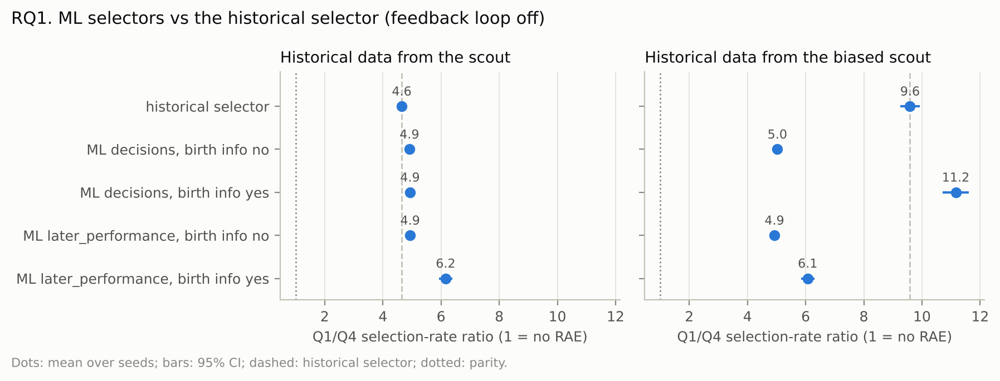

# Relative Age Effect and Feedback Loops in Youth Talent Selection: a Simulation Study of Bias Amplification and Mitigation

**Student:** Gasbarro Samuele
**Email:** samuele.gasbarro@studio.unibo.it
**Matriculation number (matricola):** 0001181115
**Course:** Ethics in AI, University of Bologna
**Document:** Project report (draft v0.4, work in progress)

---

## Abstract

Youth sport organisations select talent through multi-stage pathways (e.g., U12 to U18) and increasingly rely on data-driven tools. Annual age-grouping produces the Relative Age Effect (RAE): athletes born early in the selection year are systematically over-selected, because relative age is confounded with biological maturation. A model trained on past selection outcomes may inherit this bias and amplify it through a feedback loop: selected athletes receive more coaching and playing time, which improves their observed performance and reinforces later selections. Since real youth data are scarce and true talent is never observable, this project builds a seeded and tested Python simulator of a multi-stage selection pipeline in which latent talent is independent of birth date by construction. This makes it possible to measure directly the harm of biased selection, i.e., talented athletes born late in the year who are excluded. The study asks (RQ1) how much machine-learning selectors amplify the RAE compared with the bias already present in the data, (RQ2) whether the training-exposure feedback loop increases talent loss across stages and cohorts, and (RQ3) which mitigations (relative-age-adjusted scores, bio-banding, birth-quarter quotas, rotating selection slots) reduce talent loss and at what cost in selection efficiency. Results are reported with fairness metrics, efficiency metrics, multiple random seeds and confidence intervals. The project addresses the Trustworthy AI requirements of fairness, transparency and societal well-being, and uses no personal data. The simulator explores mechanisms and compares mitigations; it does not predict real-world outcomes.

---

## 1. Context and research questions

The Relative Age Effect (RAE) is a well-documented advantage for athletes born early in the
selection year (Cobley et al., 2009). A recent systematic review of machine learning in youth talent
identification recommends fairness audits across relative-age quartiles, sex and maturation
status (Tang et al., 2026). Real youth data are scarce and true talent is unobservable, so the harm
of biased selection cannot be measured directly; a simulation with known latent talent makes it
measurable.

- **RQ1.** How much does a selector trained on historical outcomes amplify the RAE, compared with
  the bias already present in the data?
- **RQ2.** Does the training-exposure feedback loop increase talent loss across successive stages
  and cohorts?
- **RQ3.** Which mitigations reduce talent loss, and at what cost in selection efficiency?

## 2. Model specification (draft)

**Athletes.** For athlete *i*, latent talent is T_i ~ N(0, 1), independent of birth date. The birth
date is U_i ~ Uniform[0, 1), the fraction of the selection year elapsed since the cut-off
(0 = oldest in the age group). The birth quarter Q_i is floor(4 U_i) + 1. Standardised relative age
is ra_i = (1/2 - U_i) / sqrt(1/12), and biological maturation is
M_i = rho * ra_i + sqrt(1 - rho^2) * e_i with e_i ~ N(0, 1), so M has unit variance and correlation
rho with relative age.

**Pipeline.** There are S stages. At stage s, all athletes still in the system (the pool) are
observed, and the top k_s = round(f_s * N) are selected, where f_s is a non-increasing fraction of
the initial cohort of N athletes. Observed performance is

    P_(i,s) = a * T_i + b_s * M_i + c * E_(i,s) + sigma * z_(i,s),   b_s = b_0 * delta^s,

where z is standard normal noise, delta < 1 makes the maturation effect fade at later stages, and
E_(i,s) = g * (number of earlier stages at which i was selected) is accumulated training exposure.
Selection at stage s therefore feeds exposure at stage s + 1, which closes the feedback loop.
Athletes not selected at a stage leave the system with probability p; those who stay can be
selected at a later stage. The exposure gap opens between them and the athletes who were
selected, so the loop acts through these re-entries: in a pure pyramid (p = 1) every athlete in
the pool has the same exposure and the loop has no effect on the ranking.

**Ground truth and the meaning of exposure.** Harm is always measured against latent talent T,
which is independent of birth date by construction. Exposure raises *observed performance* but not
T: it is the head start that coaching and playing time give to athletes who were selected early.
This keeps the definition of talent loss unambiguous. (The alternative reading, exposure as real
skill growth, leads to the same equations for P and only changes the interpretation; it is
discussed in Section 6.)

**Selectors.** Every selector receives the same view of a stage: the pool, the history of observed
performance of each athlete in it, and the number of earlier selections.

- *Oracle*: ranks by T (benchmark, not implementable).
- *Memoryless performance*: ranks by the current P only.
- *Scout* (human-like): ranks by a weighted mean of the past observations of each athlete
  (a measurement taken j stages ago has weight m^j; m = 1 averages all stages), plus a fresh
  subjective judgement error of sd tau at each stage, plus optionally an explicit bias lambda * M
  towards athletes who look physically mature. The historical data on which ML models are
  trained are produced by a scout (m = 1, tau = 0.5), with lambda = 0 ("scout") or lambda = 0.5
  ("biased scout").
- *ML selectors*: a logistic/linear model or gradient boosting trained on the logs of past cohorts
  (Section 4.2).
- *Mitigations* (RQ3), each wrapping a base selector (scout or ML):
  - *relative-age-adjusted scores*: the within-pool linear trend of the scores on birth position
    is estimated and a share (the strength) of it is subtracted;
  - *birth-quarter quotas*: a share of the slots is reserved to each birth quarter in proportion
    to its size in the pool, filled by the best scores within the quarter;
  - *bio-banding*: the same, with three bands of *estimated* maturation (error sd 0.5, redrawn at
    each stage) instead of birth quarters, so that athletes compete with peers of similar maturity;
  - *rotating selection slots*: at the development stages (not the final one) a share of the
    slots goes to athletes drawn at random among the next k below the cut, which spreads training
    exposure over more athletes.

**Metrics (latent talent known).** With "high talent" meaning the top 10% of T:

- *Talent loss*: share of high-talent athletes not selected, overall and by birth quarter, at the
  final stage and at every stage; the loss among Q4 athletes is the harm named in the abstract
  (talented athletes born late in the year who are excluded); *equal-opportunity gap*: largest difference in talent loss
  across quarters.
- *Selection-rate ratio* Q1/Q4 among all athletes (1 means birth date plays no role); this
  measures *disparity*, which is not the same as *harm*: a selector can increase the ratio and
  still lose fewer talented athletes (Section 5).
- *Efficiency*: mean latent talent of the selected cohort; *regret*: gap to an oracle cohort of the
  same size.

Results are averaged over independent seeds and reported with 95% Student-t confidence intervals.
Selectors compared under the same seed face identical athletes and noise, so their differences
are paired.

## 3. Goals and deliverables

| Level | Goal | Deliverable |
|---|---|---|
| Core | Simulator and baseline selectors; answer RQ1 and RQ2 | Tested Python code, plots, confidence intervals over multiple seeds |
| Extended | Mitigations (RQ3: the four listed in the proposal, at least two); sensitivity analysis | Pareto curves of talent loss vs efficiency; sensitivity study |
| Stretch | Explanation analysis; calibration to the literature | Feature-attribution study of birth-quarter proxies; calibrated RAE magnitude |

Trustworthy AI requirements addressed: fairness and non-discrimination (main focus), transparency
(open modelling assumptions), societal well-being (youth participation) and human agency
(mitigations support coaches and scouts rather than replace them). No personal data are used.

## 4. Implementation

### 4.1 Package and build

Python package `rae` (NumPy, pandas, scikit-learn, SciPy, Matplotlib), tested with pytest and linted with ruff;
Makefile as build automation; continuous integration (lint and tests) on every push and merge
request. Runs are seeded, and athletes, noise, dropout and selector draws (e.g., scout judgement
error) come from separate random streams, so that selectors compared under the same seed face
identical athletes (common random numbers). See `README.md` for the repository layout.

At each stage the pipeline builds a *stage context* (stage, pool, observed-performance history,
earlier selections, selector random stream) and asks the selector for one score per athlete; the
top k_s scores are selected. New selectors only need to implement this interface; selectors that
decide *who* is selected in another way (quotas, bands, rotating slots) can also return the chosen
positions directly, and the pipeline checks that they are k distinct members of the pool.

### 4.2 Stage logs and learning selectors

Each run records, for every stage, the pool, the observed-performance history, the number of
earlier selections of each athlete and the selection decision. These logs are the "historical
data" on which machine-learning selectors are trained. Features are the current observed
performance, the mean observed performance over all stages so far (the same memory a scout has),
the number of earlier selections (training exposure) and the stage; birth information (position
in the selection year) can be withheld or added, to test fairness through unawareness. Two
labelling regimes are implemented: *decisions* (label = past selection decision of the scout) and
*later performance* (label = performance observed at the next stage, available only for athletes
still in the system, a selective-labels problem). Models are a linear/logistic model (default)
and gradient boosting. The feature set can be restricted, which is used for the ablation study.

### 4.3 Retraining across cohorts

Generation 0 is historical data from the scout. A model trained on it is deployed on the next
cohorts (generation 1), then retrained on its own decisions and outcomes, and so on. Each cohort
is an independent birth year simulated from its own seed, so the only channel through which one
cohort affects the next is the data the model is retrained on.

### 4.4 Invariants (tested)

Written before the experiments, in a test-driven spirit:

- talent is independent of birth date; maturation has the requested correlation with relative age;
- the oracle loses no high-talent athlete when the final selection share is at least the
  high-talent share, and shows no RAE even when observations are biased;
- with no maturation and no exposure effect, no RAE appears, for the memoryless selector, for a
  noisy scout with memory, for every ML selector (both regimes, with or without birth information)
  and along the retraining loop;
- the RAE grows with the strength of maturation and with the scout's maturation bias;
- the feedback loop increases the Q1/Q4 ratio for the same athletes and noise; for a scout with
  memory it also increases talent loss and regret (large cohort, strong loop);
- a decision-imitation model reproduces a noiseless historical selector (overlap above 95-98%);
- a scout without memory is exactly the memoryless selector; the observed-performance history
  is complete and consistent with the earlier stages;
- every mitigation at strength 0 reproduces its base selector; relative-age adjustment removes the
  linear birth trend exactly; quotas and bands fill every group in proportion; rotating slots
  only rotate below the cut and leave the final stage alone; relative-age adjustment, quotas and
  bio-banding cut the scout's Q1/Q4 ratio by at least 40%; rotation spreads exposure over more
  athletes.

### 4.5 Experiments and figures

Each research question has a script in `experiments/` (`make baseline`, `make rq1`, `make rq2`,
`make ablation`, `make rq3`); they write one CSV row per run to `results/` (not tracked), and
`make figures` draws the report figures from those files into `report/figures/`. Shared settings
(scout presets, exposure weights) live in `experiments/common.py`.

## 5. Experiments and results

All numbers in this section are **preliminary**: placeholder parameters (Section 6), 20,000
athletes per cohort, 20 seeds (10 for RQ2), linear models unless stated. They will be re-run once
the parameters are justified and complemented by a sensitivity study.

### 5.1 Baseline: memory and the feedback loop

Final stage, mean over 20 seeds (95% CI half-width about 0.01 for losses and 0.1-0.2 for ratios):

| Selector | Loop | Q1/Q4 ratio | Talent loss | EO gap | Regret |
|---|---|---|---|---|---|
| Oracle | off/on | 0.99 | 0.000 | 0.000 | 0.000 |
| Memoryless performance | off | 2.73 | 0.556 | 0.286 | 0.580 |
| Memoryless performance | on (c = 1) | 3.85 | 0.518 | 0.381 | 0.491 |
| Scout with memory | off | 4.46 | 0.544 | 0.411 | 0.551 |
| Scout with memory | on (c = 1) | 4.84 | 0.545 | 0.431 | 0.554 |

Two observations shaped the model. First, for a *memoryless* selector the loop *reduces* talent
loss: the number of earlier selections summarises earlier measurements, so exposure acts as a
memory that averages out measurement noise, in addition to creating bias. Comparing loop on/off
for that selector therefore confounds two effects. For a scout who already remembers past
observations, exposure adds no information about talent, and the comparison isolates the bias.
Second, memory itself is a channel of the RAE: averaging all stages keeps the early,
maturation-heavy impressions alive (ratio 4.46 against 2.73).

### 5.2 RQ1: amplification by ML selectors

Q1/Q4 ratio on a fresh test cohort, loop off, mean over 20 seeds; in brackets the paired
difference with the historical selector. Linear/logistic models, and gradient boosting (GBM):

| Selector | Scout, linear | Scout, GBM | Biased scout, linear | Biased scout, GBM |
|---|---|---|---|---|
| Historical selector | 4.65 | 4.65 | 9.59 | 9.59 |
| ML decisions, no birth info | 4.91 (+0.26 ± 0.15) | 4.89 (+0.24 ± 0.15) | 5.03 (-4.56) | 5.04 (-4.55) |
| ML decisions, birth info | 4.93 (+0.28 ± 0.15) | 4.87 (+0.22 ± 0.17) | 11.16 (+1.57 ± 0.38) | 11.56 (+1.97 ± 0.58) |
| ML later perf., no birth info | 4.94 (+0.29 ± 0.14) | 4.89 (+0.25 ± 0.13) | 4.93 (-4.66) | 4.89 (-4.70) |
| ML later perf., birth info | 6.16 (+1.51 ± 0.22) | 4.43 (-0.22 ± 0.20) | 6.07 (-3.52) | 4.49 (-5.10) |

Every ML selector loses fewer talented athletes than the selector that produced its training data
(talent loss 0.50-0.55, against 0.55 for the scout and 0.64 for the biased scout). Three
mechanisms appear.

1. *Denoising.* A model imitating a noisy scout keeps the systematic part of the judgement and
   drops the noise: disparity grows slightly (+0.2 to +0.3 in the ratio, with both model
   classes) while talent loss falls. Amplification of disparity and harm do not go together.
2. *Proxy reconstruction.* The biased scout favours physically mature athletes, which the model
   cannot see. Without birth information the model cannot reproduce that bias (fairness through
   unawareness works here, ratio 9.6 to 5.0); with birth information it uses birth date as a
   proxy for maturation and amplifies the bias beyond the historical selector (+1.6 linear,
   +2.0 GBM). This result does not depend on the model class.
3. *Label bias, mediated by the model specification.* Performance at the next stage still contains
   maturation, with a weight that falls from stage to stage. A diagnostic fit on the scout's logs
   gives a birth coefficient that rewards early birth when predicting stage 1 from stage 0
   (-0.32 per unit of birth position) and corrects in the opposite direction when predicting
   stage 2 from stage 1 (+0.11). The linear model pools all stages into one coefficient and
   carries the early-stage label bias into the final selection (+1.5); gradient boosting fits
   stage-specific effects and does not amplify (-0.2 ± 0.2). Whether a model trained on later
   performance amplifies the RAE is therefore a property of the model as well as of the data,
   which argues for auditing each deployed model rather than the data alone.

With the loop on the picture is the same (e.g., decisions with birth info on biased-scout data:
+1.3 linear, +1.5 GBM; later performance with birth info on scout data: +1.0 linear, -0.3 GBM).

**Ablation: which features carry birth information?** In the training logs, birth position is
correlated with every performance feature (current performance -0.29, history mean -0.34, number
of earlier selections -0.20); together they explain 12.5% of its variance. Removing features from
birth-blind models (paired change of the ratio vs the scout, loop off):

| Features (no birth info) | Decisions | Later performance | Talent loss |
|---|---|---|---|
| All | +0.26 ± 0.15 | +0.29 ± 0.14 | 0.506 |
| Without number of earlier selections | +0.25 ± 0.15 | +0.25 ± 0.15 | 0.506 |
| Without history mean | -0.67 ± 0.11 | -0.71 ± 0.10 | 0.519 |
| Current performance and stage only | -1.91 ± 0.08 | -1.91 ± 0.08 | 0.555 |

The proxy is the *memory* of past performance, not the count of past selections, as conjectured
in an earlier draft. Removing it lowers the disparity but raises talent loss: the history mean
also carries most of the information about talent, so "removing the proxy" is itself a
fairness-efficiency trade-off.

### 5.3 RQ2 across stages

Scout with memory, mean over 10 seeds, stages 0 / 1 / 2:

| Exposure weight c | Q1/Q4 ratio | Talent loss | EO gap |
|---|---|---|---|
| 0 | 2.90 / 3.50 / 4.43 | 0.303 / 0.373 / 0.545 | 0.343 / 0.402 / 0.412 |
| 1 | 2.90 / 3.67 / 4.79 | 0.303 / 0.376 / 0.546 | 0.343 / 0.415 / 0.434 |
| 2 | 2.90 / 3.72 / 4.78 | 0.303 / 0.381 / 0.547 | 0.343 / 0.415 / 0.431 |

The loop increases disparity across stages (ratio and equal-opportunity gap), but with the current
parameters its effect on the overall final talent loss is within noise (paired difference at
c = 1: +0.0005 ± 0.004). The exposure bonus mostly goes to athletes who were already selected and
are on average talented, so the loop shifts *which* talented athletes are lost (more late-born)
more than *how many*. For the memoryless selector the loop reduces talent loss (-0.037 ± 0.004 at
c = 1), for the reason given in Section 5.1.

### 5.4 RQ2 across cohorts

Moving from the scout to an ML selector causes a one-off level shift at generation 1 (e.g., ratio
4.43 to 6.33 for the linear model on later performance with birth info); retraining on its own
decisions for four further generations does not compound the ratio further (6.25-6.51), and
talent loss stays flat. Cohorts are independent, so the only memory across generations is the
model, and with the current features it reaches a fixed point after one retraining.

### 5.5 RQ3: mitigations

Paired change with respect to the unmitigated selector, loop on (c = 1), mean over 20 seeds:

| Mitigation | Scout: Q1/Q4 | Scout: d Q4 loss | Scout: d regret | ML: Q1/Q4 | ML: d Q4 loss | ML: d regret |
|---|---|---|---|---|---|---|
| None | 4.89 | - | - | 5.87 | - | - |
| RA-adjusted 0.5 | 1.94 | -0.141 | -0.052 | 1.60 | -0.200 | -0.071 |
| RA-adjusted 1.0 | 0.99 | -0.251 | -0.065 | 1.01 | -0.284 | -0.078 |
| Quota 0.5 | 3.74 | -0.046 | -0.011 | 3.87 | -0.070 | -0.015 |
| Quota 1.0 | 1.00 | -0.246 | -0.060 | 1.00 | -0.282 | -0.072 |
| Bio-banding 0.5 | 3.75 | -0.061 | -0.050 | 4.31 | -0.067 | -0.051 |
| Bio-banding 1.0 | 1.61 | -0.219 | -0.144 | 1.76 | -0.240 | -0.142 |
| Rotating 0.2 | 4.95 | +0.002 | +0.007 | 6.07 | +0.010 | +0.017 |
| Rotating 0.4 | 4.89 | +0.001 | +0.016 | 6.27 | +0.020 | +0.045 |

(ML = linear model trained on later performance with birth info, the strongest amplifier in RQ1.
95% CI half-widths are about 0.01 for the changes in loss and 0.005 for regret.)

- *Relative-age adjustment and full quotas* remove the disparity (ratio about 1, equal-opportunity
  gap from 0.44 to 0.04) and cut the loss among Q4 athletes from 0.77 to about 0.51, **and
  improve efficiency** (lower regret). In this model the RAE is pure error with respect to talent, so
  removing it can only help; there is no fairness-efficiency trade-off to pay.
- *Bio-banding* is the most efficient mitigation (regret -0.14) because it removes the maturation
  advantage within birth quarters too, which a birth-based correction cannot see; it leaves some
  disparity (ratio about 1.6) because exposure and memory still favour early-born athletes.
- *Rotating slots* do not help: with the current parameters the loop has little effect on talent
  loss (Section 5.3), so spreading exposure only costs efficiency.
- Results are similar with the loop off.

The absence of a trade-off is a consequence of an assumption, not a finding about the real world:
the maturation advantage is modelled as transient and unrelated to talent. If part of it predicted
adult performance, the mitigations would have a cost; this is the first item of the sensitivity
study.

## 6. Modelling decisions

### 6.1 Decision log

- **D1. Exposure and the human-like baseline.** Harm is measured against latent talent T, and
  exposure is a head start on observed performance, not a change of T. Because a count of earlier
  selections is also a memory of earlier measurements, the reference human-like selector is a
  scout *with memory*; the memoryless selector is kept as a contrast. Reading exposure as real
  skill growth would give the same equations for P; it was not chosen because it would make the
  ground truth depend on the selection itself and blur the definition of talent loss.
- **D2. Historical data from noisy and biased scouts.** A noiseless performance-based selector is a
  deterministic function of the features the ML model sees, so imitation is exact and the
  *decisions* regime could not show anything. Historical data now come from a scout with
  judgement noise and, in a second condition, a bias towards physical maturity.
- **D3. Independent cohorts.** Each cohort is a new birth year; the cross-cohort feedback loop of
  RQ2 is the retraining of the model on its own outputs. No other persistence is modelled.
- **D4. Talent loss at every stage**, not only at the final one, as RQ2 asks about stages.
- **D5. Student-t confidence intervals**, since the number of seeds is small (10-30).
- **D6. Mitigations as wrappers.** Every mitigation wraps a base selector, so the same mitigation
  can be applied to a scout or to an ML model and compared on the same test cohort. Bio-banding
  uses an estimate of maturation with error, not the true value; rotation is limited to the
  development stages, since the final squad should not contain random picks.
- **D7. Report figures are tracked.** Figures are generated by `make figures` but kept in
  `report/figures/`, so that the Markdown report renders on its own.

### 6.2 Open decisions

- **Cut-off rule.** Which selection-year cut-off the Italian youth categories use (to be verified
  and cited), and how it affects the birth-quarter definition.
- **Parameter values.** Defaults in `SimConfig` and in the scout presets are placeholders; each
  needs a justification or a sensitivity range (and, as a stretch goal, calibration to published
  RAE effect sizes). The size of the loop effect on talent loss (Section 5.3) depends on them.
- **Perceived maturity.** The biased scout weighs true maturation M; a noisy perception of M
  would be more realistic and is also needed for bio-banding (RQ3).
- **Model specification of the ML selectors.** A linear model with stage interactions would test
  directly the explanation of the linear/GBM difference in RQ1 (Section 5.2).
- **Persistent maturation advantage.** Part of the maturation effect could be allowed to predict
  adult performance, to measure the cost of the mitigations (Section 5.5).
- **Feedback-loop strength.** The loop barely changes overall talent loss with c up to 2; a stronger
  loop (larger exposure gain, lower dropout) is needed to test whether rotating slots can help.
- **Selective labels.** Dropped-out athletes have no later performance; the effect of this on the
  trained models is not yet analysed.
- **Definition of "high talent"** (top 10% by default) and its sensitivity.

## 7. Limitations

The simulator is a stylised model: it explores mechanisms and compares mitigations, but its absolute
numbers depend on assumed parameters and do not predict real outcomes.

---

## References

- Cobley, S., Baker, J., Wattie, N., McKenna, J. (2009). Annual age-grouping and athlete development:
  a meta-analytical review of relative age effects in sport. *Sports Medicine*, 39(3), 235-256.
- Tang, Q., Wei, X., Tan, B. (2026). The Role of Machine Learning in Talent Identification for Team
  Sports: A Systematic Review. *Journal of Sports Science and Medicine*, 25, 58-83.
